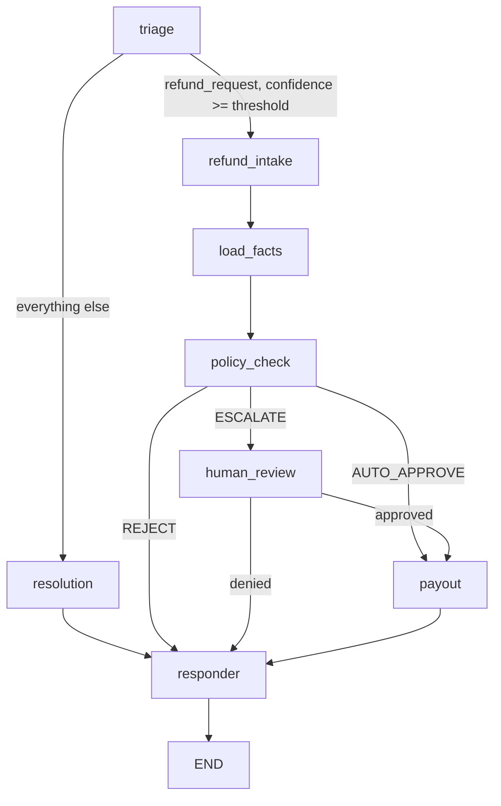

# State model

Source of truth: `backend/app/contracts/state.py` (`CaseState`). One LangGraph thread per case,
`thread_id` stored on the case row, checkpointed with PostgresSaver.

## Graph

`human_review` calls `interrupt()`; the reviewer decision resumes it with
`Command(resume=ReviewDecision(...).model_dump(mode="json"))`.

## Who writes what

| Field | Written by | Kind |
|---|---|---|
| `messages` | API layer, responder | plain code |
| `triage` | triage | LLM, validated `TriageOutput` |
| `intake` | refund_intake | LLM, validated `RefundIntakeOutput` |
| `facts` | load_facts | plain code, from the database |
| `policy_result` | policy_check | plain code (`policy/engine.py`) |
| `review` | human_review | reviewer, via the decision endpoint |
| `payout` | payout | plain code, the only caller of `PayoutGateway` |
| `reply` | responder | LLM, from verified fields only |
| `status`, `current_node`, `last_node_status` | every node | plain code |
| `handoff_reason` | any node on unrecoverable failure | plain code |

The LLM never writes `facts`, `policy_result`, `review` or `payout`.

## Status transitions

| From | Event | To |
|---|---|---|
| `open` | policy REJECT | `rejected` |
| `open` | policy ESCALATE | `pending_approval` |
| `open` | policy AUTO_APPROVE, payout done | `paid` |
| `open` | non-refund question answered | `answered` |
| `open` | invalid LLM output twice, or provider chain exhausted | `handed_off` |
| `pending_approval` | reviewer approves, payout done | `paid` |
| `pending_approval` | reviewer denies | `denied` |

`rejected`, `paid`, `denied`, `answered` and `handed_off` are terminal for the refund flow.

The Phase 7 mock gateway stores one processed payout per case in `payouts`. Its
`refund:<case_id>` idempotency key makes retries and repeated approval submissions return the
same payout result. Beneficiary account numbers are used only to build the request and are
stored and returned in masked form.

## Facts and the refund amount

- `load_facts` fetches the order by `intake.order_id` and the caller's `customer_id`, and computes `refund_amount_paise`:
  - `intake.items` given: sum of `line_total_paise` of the matching DB items.
  - `intake.items` empty: the whole order total.
- The amount never comes from the client or the LLM. `RefundIntakeOutput` forbids extra fields, so an `amount` key makes the LLM output invalid.
- Return window: counted from `delivered_at`, falling back to `ordered_at`. A refund is inside the window while whole elapsed days are `<= return_window_days`. `as_of` is injected so tests control the clock.
- Remaining refundable amount is `total_paise - refunded_paise`.

## Policy result

`policy/engine.py` `evaluate_refund(facts, reason, config)` is pure code: no database, clock, network or LLM.
It evaluates every rule and reports all of them, so customers and reviewers see every reason.

| Rule | Passes when | On failure |
|---|---|---|
| `order_exists_and_owned` | order found and belongs to the requester | REJECT (the only rule reported if it fails) |
| `payment_captured` | payment status is `captured` | REJECT |
| `within_return_window` | whole days since delivery (else since order) `<= return_window_days` | REJECT |
| `within_refundable_amount` | `0 < amount <= total - already refunded` | REJECT |
| `reason_eligible` | reason is in `eligible_reasons` | REJECT |
| `refund_velocity` | refunds by this customer in the last 30 days `< max_refunds_per_customer_30d` | ESCALATE |
| `auto_approve_eligible` | `amount < auto_approve_below_paise` and no fraud flag | ESCALATE (REJECT for the amount part when `escalate_at_or_above_threshold` is false) |

Not-found and not-yours orders give the identical answer, so order ids cannot be probed.

- `PolicyResult.rules` is the per-rule list `(rule, passed, reason)`, persisted with the case and shown on the policy card.
- Precedence is REJECT > ESCALATE > AUTO_APPROVE: the decision is the strongest outcome among the failed rules. The model enforces consistency: `AUTO_APPROVE` only if every rule passed; `REJECT` or `ESCALATE` only if some rule failed.
- `reason` text is customer-visible. It must never mention internal signals such as the fraud flag.

## Failure and handoff

- Invalid LLM output: retry once, then `handed_off` with `handoff_reason` and the full state kept.
- Provider rate-limited or erroring: backoff with retry (respecting `Retry-After`), then the fallback provider once it exists (Phase 10), then `handed_off`.
- A `handed_off` case appears in the reviewer queue but has no approve/deny action.

## Audit trail

Every node transition writes one `audit_events` row: `(case_id, node, status, detail, at)`. `detail` holds
ids, decisions, versions and durations only, never customer text or PII. Customers see a reduced
`timeline` (node, status, time); reviewers see the full audit trail and trace link.
